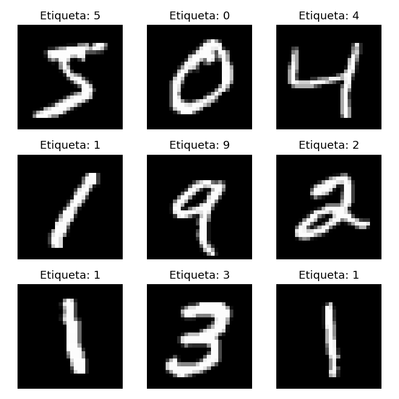
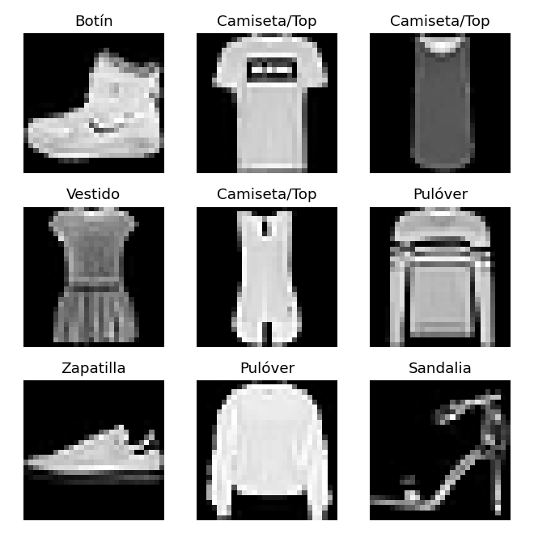

# Práctica de Laboratorio 05: Arquitecturas CNN y Análisis de Resultados (MNIST vs. Fashion-MNIST)

**Curso:** SIS070 - Inteligencia Artificial
**Unidad:** Unidad II - Redes Neuronales Convolucionales
**Tema:** Redes Neuronales Convolucionales
**Alumno:** Auccapiña Bombilla Rodrigo Fabricio - 021200266k
            Huillca Monterola Aderly Aldair - 022100363c
            Rodrìguez Castro Luz Dioneth – 021201359B
            Tapia Palomino Andy Sebastian – 022100575K


---

## Estructura del repositorio

```
practica-cnn-comparativa/
│
├── mnist_cnn.py        # Parte 1: Script de CNN con dígitos (MNIST)
├── fashion_cnn.py      # Parte 2: Script de CNN con prendas (Fashion-MNIST)
├── README.md           # Informe estructurado con análisis y evidencias
├── .gitignore          # Exclusión de archivos temporales (__pycache__, venv/)
└── capturas/           # Evidencias gráficas generadas con matplotlib
    ├── mnist_muestras.png
    └── fashion_muestras.png
```

## Cómo ejecutar

```bash
pip install tensorflow numpy matplotlib
python mnist_cnn.py
python fashion_cnn.py
```

Cada script abre primero una ventana con 9 imágenes del dataset; al cerrarla continúa el entrenamiento y la predicción.

> **Entorno de ejecución:** Windows, Python 3.10.4, TensorFlow 2.21.0 (CPU), VS Code.

> **Nota sobre los resultados:** los pesos iniciales de la red son aleatorios, por lo que los valores de *loss*, *accuracy* y del vector Softmax pueden variar ligeramente entre ejecuciones. Los shapes y el número de parámetros son siempre los mismos.

> **Corrección al código de la guía:** en `fashion_cnn.py`, la última línea de la guía (`print(f"Clase real: ... (Índice {y_test[0]})} ")`) tiene una llave `}` de más, lo que produce `SyntaxError: f-string: single '}' is not allowed`. Se eliminó esa llave para que el script ejecute. Además, ambos scripts imprimen al final la suma del vector Softmax como apoyo a la actividad 1.4.

---

# PARTE 1: Dígitos escritos a mano (MNIST)

## Salida obtenida en consola

```
Model: "sequential"
┏━━━━━━━━━━━━━━━━━━━━━━━━━━━━━━━━━┳━━━━━━━━━━━━━━━━━━━━━━━━┳━━━━━━━━━━━━━━━┓
┃ Layer (type)                    ┃ Output Shape           ┃       Param # ┃
┡━━━━━━━━━━━━━━━━━━━━━━━━━━━━━━━━━╇━━━━━━━━━━━━━━━━━━━━━━━━╇━━━━━━━━━━━━━━━┩
│ Conv_1 (Conv2D)                 │ (None, 26, 26, 32)     │           320 │
│ MaxPool_1 (MaxPooling2D)        │ (None, 13, 13, 32)     │             0 │
│ Conv_2 (Conv2D)                 │ (None, 11, 11, 64)     │        18,496 │
│ MaxPool_2 (MaxPooling2D)        │ (None, 5, 5, 64)       │             0 │
│ Aplanado_Flatten (Flatten)      │ (None, 1600)           │             0 │
│ Capa_Densa_Oculta (Dense)       │ (None, 64)             │       102,464 │
│ Salida_Softmax (Dense)          │ (None, 10)             │           650 │
└─────────────────────────────────┴────────────────────────┴───────────────┘
 Total params: 121,930 (476.29 KB)
 Trainable params: 121,930 (476.29 KB)
 Non-trainable params: 0 (0.00 B)

--- Entrenando el modelo MNIST (5000 muestras, 1 época) ---
79/79 ━━━━━━━━━━━━━━━━━━━━ 4s 20ms/step - accuracy: 0.7500 - loss: 0.8724

--- Analizando Resultados de Predicción (MNIST) ---
Vector de probabilidades crudas (Softmax):
[0.000e+00 0.000e+00 0.000e+00 3.000e-04 0.000e+00 0.000e+00 0.000e+00
 9.994e-01 0.000e+00 3.000e-04]
Clase predicha por el modelo: 7
Clase real de la imagen: 7
Suma del vector Softmax: 1.0000
```

## 1.1 Inspección visual del dataset



Las 9 primeras imágenes de entrenamiento corresponden a las etiquetas 5, 0, 4, 1, 9, 2, 1, 3, 1. Se observa lo siguiente:

- Cada imagen es una matriz de **28 × 28 píxeles en escala de grises** (un solo canal), con valores enteros entre 0 y 255.
- El **fondo es negro (0)** y el **trazo es blanco/gris claro** (valores altos). Los bordes del trazo tienen tonos intermedios por el suavizado (*anti-aliasing*) aplicado al digitalizar.
- Los dígitos están **centrados** y ocupan aproximadamente la región central de ~20 × 20 píxeles; los bordes de la imagen están casi siempre vacíos.
- Hay **variabilidad de escritura**: grosor del trazo, inclinación y forma (por ejemplo, el "1" puede ser recto o inclinado, el "4" abierto o cerrado).

**¿Por qué es útil ver los datos crudos antes de entrenar?** Porque permite verificar que los datos se cargaron correctamente y que las etiquetas corresponden a las imágenes; confirma el rango de valores (0–255), lo que justifica la normalización `/ 255.0`; muestra el formato (28 × 28 sin canal), lo que justifica el `np.expand_dims(..., -1)` para obtener `(28, 28, 1)`; y da una idea de la dificultad del problema (trazos simples sobre fondo uniforme), que ayuda a anticipar el rendimiento esperado y a detectar errores o datos defectuosos antes de gastar tiempo entrenando.

## 1.2 Inspección de `model.summary()` y shapes

**Conv_1: de 28 × 28 a 26 × 26.** Una convolución sin *padding* (`padding='valid'`, valor por defecto en Keras) solo coloca el kernel en posiciones donde cabe completo dentro de la imagen. La fórmula del tamaño de salida es:

$$\text{salida} = \frac{N - K + 2P}{S} + 1 = \frac{28 - 3 + 0}{1} + 1 = 26$$

donde N = 28 (entrada), K = 3 (kernel), P = 0 (sin padding) y S = 1 (stride). Intuitivamente, el centro de un kernel de 3 × 3 no puede ubicarse sobre la fila/columna del borde, así que se pierde 1 píxel por cada lado: 28 − 2 = 26. Como la capa tiene **32 filtros**, la salida es `(26, 26, 32)`: 32 mapas de características, uno por filtro.

**MaxPool_1: de 26 × 26 a 13 × 13.** `MaxPooling2D(pool_size=(2,2))` usa por defecto un stride igual al tamaño de la ventana (2). Divide cada mapa en bloques de 2 × 2 sin solapamiento y conserva solo el valor máximo de cada bloque: 26 / 2 = 13. La cantidad de canales no cambia (32), así que la salida es `(13, 13, 32)`. Esta capa **no tiene parámetros entrenables** (0 en el resumen), reduce a la cuarta parte la cantidad de valores, aporta cierta invariancia a pequeños desplazamientos y conserva las activaciones más fuertes.

**Resto de la red:**

| Capa | Cálculo | Shape de salida |
|---|---|---|
| Conv_2 | 13 − 3 + 1 = 11, 64 filtros | (11, 11, 64) |
| MaxPool_2 | ⌊11 / 2⌋ = 5 (la última fila/columna impar se descarta) | (5, 5, 64) |
| Flatten | 5 × 5 × 64 | (1600) |
| Capa_Densa_Oculta | 64 neuronas | (64) |
| Salida_Softmax | 10 clases | (10) |

`None` en la primera dimensión es el tamaño del lote (*batch*), que se define en tiempo de ejecución.

## 1.3 Análisis de parámetros

**Conv_2 (18,496 parámetros).** Cada filtro de Conv_2 tiene un kernel de 3 × 3 que recorre **los 32 canales** que entrega MaxPool_1, más un sesgo (*bias*):

$$\text{pesos por filtro} = 3 \times 3 \times 32 = 288$$
$$\text{parámetros} = (3 \times 3 \times 32 + 1) \times 64 = 289 \times 64 = 18{,}496$$

Es decir, 18,432 pesos + 64 sesgos. Como comparación, Conv_1 tiene (3 × 3 × 1 + 1) × 32 = 320, porque su entrada solo tiene 1 canal.

**Verificación del total:**

| Capa | Fórmula | Parámetros |
|---|---|---|
| Conv_1 | (3·3·1 + 1) · 32 | 320 |
| Conv_2 | (3·3·32 + 1) · 64 | 18,496 |
| Capa_Densa_Oculta | 1600 · 64 + 64 | 102,464 |
| Salida_Softmax | 64 · 10 + 10 | 650 |
| **Total** | | **121,930** |

**Función de Flatten como puente estructural.** Las capas convolucionales producen tensores 3D `(alto, ancho, canales)` que conservan la estructura espacial, pero una capa `Dense` espera un vector 1D por muestra. `Flatten` convierte el tensor `(5, 5, 64)` en un vector de **1600** valores, sin modificar ningún dato y sin parámetros (0 en el resumen). Así, las características extraídas por las convoluciones (bordes, curvas, partes de dígitos) pasan a las capas densas, que las combinan para tomar la decisión de clasificación. Nótese que la capa densa que sigue concentra la mayor parte de los parámetros (102,464 de 121,930, un 84%), precisamente porque conecta cada uno de los 1600 valores con cada neurona.

## 1.4 Interpretación de resultados en consola

Vector Softmax obtenido para `X_test[0]`:

| Índice (dígito) | 0 | 1 | 2 | 3 | 4 | 5 | 6 | **7** | 8 | 9 |
|---|---|---|---|---|---|---|---|---|---|---|
| Probabilidad | 0.0000 | 0.0000 | 0.0000 | 0.0003 | 0.0000 | 0.0000 | 0.0000 | **0.9994** | 0.0000 | 0.0003 |

**Suma:** 0.0003 + 0.9994 + 0.0003 = **1.0000** (el script también imprime la suma exacta: 1.0000). Los valores que aparecen como 0.0000 no son exactamente cero, sino menores a 0.00005, que se pierden al redondear a 4 decimales.

**¿Qué representa esa suma?** La función Softmax transforma las 10 salidas crudas (*logits*) de la última capa en una **distribución de probabilidad**:

$$P(\text{clase } i) = \frac{e^{z_i}}{\sum_{j=0}^{9} e^{z_j}}$$

Cada valor está entre 0 y 1 y todos suman exactamente 1, porque cada término se divide entre la suma total. La suma igual a 1 significa que la red reparte el 100% de su "confianza" entre las 10 clases posibles, que son mutuamente excluyentes.

**¿Cómo decide `np.argmax()`?** `np.argmax(predicciones)` recorre el vector y devuelve el **índice** (posición) del valor más alto, no el valor en sí. Aquí el máximo es 0.9994 en la posición 7, así que la clase predicha es **7**. Como en MNIST el índice coincide con el dígito, el índice es directamente la respuesta. Al contrastarlo con `y_test[0] = 7`, la predicción es **correcta**, y con una confianza del 99.94%. Las únicas otras clases con probabilidad visible fueron el 3 y el 9 (0.03% cada una), lo cual tiene sentido visual: el 7 comparte con el 9 un trazo superior horizontal y una línea descendente, y con el 3 el trazo superior curvo hacia la derecha.

---

# PARTE 2: Clasificación de prendas (Fashion-MNIST)

## Salida obtenida en consola

```
Model: "sequential"
┏━━━━━━━━━━━━━━━━━━━━━━━━━━━━━━━━━┳━━━━━━━━━━━━━━━━━━━━━━━━┳━━━━━━━━━━━━━━━┓
┃ Layer (type)                    ┃ Output Shape           ┃       Param # ┃
┡━━━━━━━━━━━━━━━━━━━━━━━━━━━━━━━━━╇━━━━━━━━━━━━━━━━━━━━━━━━╇━━━━━━━━━━━━━━━┩
│ Conv_1 (Conv2D)                 │ (None, 26, 26, 32)     │           320 │
│ MaxPool_1 (MaxPooling2D)        │ (None, 13, 13, 32)     │             0 │
│ Conv_2 (Conv2D)                 │ (None, 11, 11, 64)     │        18,496 │
│ MaxPool_2 (MaxPooling2D)        │ (None, 5, 5, 64)       │             0 │
│ Aplanado_Flatten (Flatten)      │ (None, 1600)           │             0 │
│ Capa_Densa_Oculta (Dense)       │ (None, 128)            │       204,928 │
│ Salida_Softmax (Dense)          │ (None, 10)             │         1,290 │
└─────────────────────────────────┴────────────────────────┴───────────────┘
 Total params: 225,034 (879.04 KB)
 Trainable params: 225,034 (879.04 KB)
 Non-trainable params: 0 (0.00 B)

--- Entrenando el modelo Fashion-MNIST (5000 muestras, 1 época) ---
79/79 ━━━━━━━━━━━━━━━━━━━━ 4s 26ms/step - accuracy: 0.6630 - loss: 0.9911

--- Analizando Resultados de Predicción (Fashion-MNIST) ---
Vector de probabilidades crudas (Softmax):
[2.000e-04 1.000e-04 1.900e-03 3.000e-04 2.000e-04 3.470e-02 1.000e-03
 3.007e-01 2.330e-02 6.376e-01]
Clase predicha: Botín (Índice 9)
Clase real: Botín (Índice 9)
Suma del vector Softmax: 1.0000
```

## 2.1 Inspección visual del dataset



Las 9 primeras imágenes son: Botín, Camiseta/Top, Camiseta/Top, Vestido, Camiseta/Top, Pulóver, Zapatilla, Pulóver y Sandalia. El formato es el mismo que MNIST (28 × 28, escala de grises, fondo negro), pero la complejidad visual es mucho mayor:

- **Siluetas sólidas vs. trazos finos:** los dígitos de MNIST son líneas delgadas; las prendas son **áreas rellenas** que ocupan casi todo el cuadro (el pulóver o la camiseta llenan la imagen de borde a borde).
- **Texturas e intensidades internas:** las prendas tienen variaciones de gris dentro de la silueta (rayas del pulóver, estampado de la camiseta, pliegues del vestido, cordones del botín). En MNIST el trazo es casi uniforme.
- **Forma y orientación variables:** el calzado aparece de perfil y horizontal, mientras que la ropa superior aparece de frente y vertical. Además, dentro de una misma clase hay mucha variación (dos "Camiseta/Top" de la muestra son muy distintas: una de manga corta y otra sin mangas).
- **Clases visualmente parecidas entre sí:** Camiseta/Top, Pulóver, Abrigo y Camisa comparten una silueta de "torso con mangas"; Sandalia, Zapatilla y Botín son todos calzado. En MNIST, en cambio, la mayoría de dígitos tiene formas claramente distintas.
- **Detalles finos determinantes:** la sandalia de la muestra es casi solo un contorno de tiras muy delgadas, y diferenciar una camisa de un pulóver puede depender de un cuello o botones de pocos píxeles.

## 2.2 Análisis de la salida nominal

La red no "sabe" qué es un botín: su salida es solo un vector de 10 números, y `np.argmax()` devuelve un **entero** (aquí, 9). Ese número por sí solo es abstracto. El arreglo `class_names` actúa como una **tabla de correspondencia** (índice → nombre):

```python
class_names = ['Camiseta/Top', 'Pantalón', 'Pulóver', 'Vestido', 'Abrigo',
               'Sandalia', 'Camisa', 'Zapatilla', 'Bolso', 'Botín']
#                    0            1          2          3         4
#                    5            6          7          8         9
```

Al hacer `class_names[indice_predicho]` → `class_names[9]` se obtiene `'Botín'`, una categoría comprensible para una persona. Lo mismo se aplica a la etiqueta real: `class_names[y_test[0]]` → `'Botín'`. Así la comparación se lee directamente como "Predicha: Botín / Real: Botín" en lugar de "9 / 9".

Esto funciona porque el **orden** de la lista coincide exactamente con la codificación oficial de las etiquetas de Fashion-MNIST (0 = T-shirt/top, …, 9 = Ankle boot). Si se alterara el orden, la red seguiría prediciendo el mismo índice, pero se mostraría un nombre incorrecto. En MNIST no hace falta este arreglo porque el índice y la clase coinciden (el índice 7 *es* el dígito 7). El mismo mapeo permite interpretar cada posición del vector Softmax: por ejemplo, el 0.3007 en la posición 7 significa "30.07% de probabilidad de que sea Zapatilla".

## 2.3 Impacto de la capa densa modificada (64 → 128 neuronas)

Las capas convolucionales son idénticas en ambos modelos (mismos shapes y los mismos 18,816 parámetros). El cambio solo afecta a las dos últimas capas densas:

| Capa | MNIST (64 neuronas) | Fashion-MNIST (128 neuronas) | Diferencia |
|---|---|---|---|
| Capa_Densa_Oculta | 1600·64 + 64 = **102,464** | 1600·128 + 128 = **204,928** | +102,464 |
| Salida_Softmax | 64·10 + 10 = **650** | 128·10 + 10 = **1,290** | +640 |
| **Total de la red** | **121,930** | **225,034** | **+103,104 (≈ +84.6%)** |

Duplicar las neuronas ocultas **casi duplica el total de parámetros** de la red, porque la capa densa que recibe el vector de 1600 valores del Flatten es la que más pesa. Además, el aumento se propaga a la capa de salida, que ahora recibe 128 entradas en lugar de 64.

**Implicancia al modelar ropa vs. dígitos:** con 128 neuronas la red tiene más capacidad para **combinar** las características extraídas por las convoluciones. Esto tiene sentido en Fashion-MNIST, donde distinguir clases parecidas (camisa vs. pulóver vs. abrigo, o zapatilla vs. botín) exige combinaciones más finas de rasgos como textura, cuello, largo de manga o altura del tobillo. Para los dígitos, cuyos patrones son más simples, 64 neuronas son suficientes. El costo es mayor memoria (879 KB vs. 476 KB), más cálculo por paso y mayor riesgo de **sobreajuste** si se entrena mucho con pocos datos. Con solo 1 época y 5000 muestras, esta capacidad extra todavía no se aprovecha del todo, como muestran las métricas de la Parte 3.

---

# PARTE 3: Análisis comparativo entre ambos algoritmos y datasets

## 3.1 Comparativa de métricas de entrenamiento

| Métrica (1 época, 5000 muestras) | MNIST | Fashion-MNIST |
|---|---|---|
| Accuracy de entrenamiento | **0.7500** (75.0%) | 0.6630 (66.3%) |
| Loss de entrenamiento | **0.8724** | 0.9911 |
| Parámetros | 121,930 | 225,034 |
| Predicción de `X_test[0]` | 7 ✔ (99.94%) | Botín ✔ (63.76%) |

Ambas redes parten de una pérdida cercana a ln(10) ≈ 2.30, que es la de una predicción al azar entre 10 clases. Sin embargo, **MNIST aprende más rápido y de forma más eficiente**: termina con casi 9 puntos más de accuracy (75.0% vs. 66.3%) y una pérdida menor (0.87 vs. 0.99), **a pesar de tener casi la mitad de parámetros**.

Las razones:

1. **Patrones más simples:** un dígito queda definido por unos pocos trazos; los filtros de 3 × 3 de las primeras capas detectan rápidamente bordes y curvas que ya son casi suficientes para separar las clases.
2. **Clases más separables:** la mayoría de dígitos tiene formas muy distintas entre sí, mientras que en Fashion-MNIST varias clases comparten silueta, lo que genera más errores al principio.
3. **Más capacidad no significa aprendizaje más rápido:** la capa de 128 neuronas tiene el doble de pesos que ajustar, y con 79 pasos de gradiente (5000 / 64) no hay tiempo de aprovecharla.

Nota: el *accuracy* y *loss* que Keras muestra al final de la época es el **promedio acumulado** durante toda la época, incluidos los primeros lotes en los que la red aún no sabía nada. Por eso el modelo final es algo mejor de lo que indican estos números, aunque la comparación entre ambos datasets sigue siendo válida porque se midieron igual.

## 3.2 Complejidad visual y de patrones

| Aspecto | MNIST (dígitos) | Fashion-MNIST (prendas) |
|---|---|---|
| Representación | Trazos finos y abiertos | Siluetas sólidas y rellenas |
| Ocupación del cuadro | Centro (~20 × 20), bordes vacíos | Casi todo el cuadro |
| Información interna | Prácticamente nula (trazo uniforme) | Texturas, estampados, pliegues, rayas |
| Similitud entre clases | Baja en general (solo pares como 4/9, 3/8, 7/9) | Alta (familias de "parte superior" y "calzado") |
| Rasgo determinante | La forma global del trazo | A veces un detalle pequeño (cuello, botones, altura del tobillo) |

**Efecto en la confianza del Softmax:** cuando los patrones de una clase son distintivos y no se parecen a los de otras clases, la última capa produce un *logit* mucho más alto para la clase correcta que para el resto. Como Softmax usa exponenciales, esa diferencia se amplifica y casi toda la probabilidad se concentra en una clase (el 7 con 99.94%). En cambio, cuando la imagen comparte rasgos con varias clases, varios *logits* quedan cercanos entre sí y la exponencial ya no puede separar a uno solo: la probabilidad se reparte. En el botín, la red reconoce que es **calzado** (las tres clases de calzado suman 0.6376 + 0.3007 + 0.0347 ≈ 97%), pero le cuesta decidir **qué tipo** de calzado, porque sandalia, zapatilla y botín comparten forma horizontal, suela y posición dentro de la imagen.

## 3.3 Distribución de confianza del modelo

**MNIST: distribución fuertemente dominante (casi *one-hot*).**

- Clase 7: **0.9994**. Las otras 9 clases suman apenas 0.0006.
- La red está prácticamente segura, y acierta.

**Fashion-MNIST: distribución dispersa.**

| Clase | Probabilidad |
|---|---|
| **Botín (9)** | **0.6376** |
| Zapatilla (7) | 0.3007 |
| Sandalia (5) | 0.0347 |
| Bolso (8) | 0.0233 |
| Pulóver (2) | 0.0019 |
| Camisa (6) | 0.0010 |
| Resto | < 0.001 cada una |

- La clase ganadora solo alcanza el 63.76%; la predicción es correcta, pero con **certeza moderada**. Casi un tercio de la probabilidad (30.07%) se fue a Zapatilla, así que la red duda seriamente entre dos clases.
- La dispersión **no es aleatoria**: la probabilidad se concentra en las clases visualmente parecidas (todo el calzado) y en menor medida en Bolso, que también es un objeto compacto y sin mangas. Las prendas de torso (camiseta, pulóver, abrigo, camisa) y el pantalón reciben casi 0. Esto demuestra que la red **sí aprendió la estructura general** de los datos ("es calzado, no ropa superior"), aunque todavía no los rasgos finos que separan subclases.

**Cómo el dominio de los datos repercute en la certeza:** la certeza de la red depende de cuán **separables** son las clases en el espacio de características que aprende. En MNIST, con trazos simples y clases bien diferenciadas, una sola época basta para que el dígito caiga claramente en una región, lo que se traduce en una probabilidad cercana a 1. En Fashion-MNIST, las clases se superponen visualmente, así que las imágenes quedan cerca de la frontera entre varias clases y la probabilidad se reparte. Para aumentar la certeza en Fashion-MNIST haría falta más entrenamiento (más épocas y las 60,000 muestras), y posiblemente una arquitectura más profunda o técnicas como *data augmentation* y *dropout*. En la literatura, CNN simples como esta alcanzan alrededor de 99% en MNIST y alrededor de 90–92% en Fashion-MNIST con entrenamiento completo, lo que confirma que Fashion-MNIST es intrínsecamente el problema más difícil.

---

## Conclusiones

1. La misma arquitectura convolucional (Conv → Pool → Conv → Pool → Flatten → Dense → Softmax) funciona en ambos dominios, porque ambos usan el mismo formato de entrada (28 × 28 × 1); los shapes son idénticos y solo cambian los parámetros de las capas densas.
2. El cálculo de shapes y parámetros es determinístico: (N − K)/S + 1 para convoluciones *valid*, división entre 2 para el *pooling*, y (K·K·C_in + 1)·C_out para los parámetros convolucionales.
3. Las capas densas concentran la mayoría de los parámetros (84% en MNIST, 91% en Fashion-MNIST); duplicar la capa oculta de 64 a 128 neuronas casi duplica la red (+103,104 parámetros).
4. Con el mismo entrenamiento (1 época, 5000 muestras), MNIST obtiene mejores métricas (75.0% vs. 66.3%) y una predicción mucho más segura (99.94% vs. 63.76%), aunque ambas predicciones fueron correctas.
5. La forma del vector Softmax es un indicador de la dificultad del dominio: dominante en MNIST y dispersa entre clases parecidas en Fashion-MNIST.

---

## Subida a GitHub

```bash
git init
git add .
git commit -m "Entrega completa: Practica comparativa CNN MNIST y Fashion-MNIST con visualizacion y analisis"
git branch -M main
git remote add origin https://github.com/tu-usuario/nombre-de-tu-repo.git
git push -u origin main
```